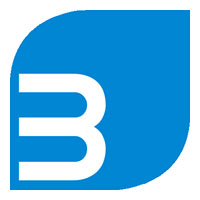
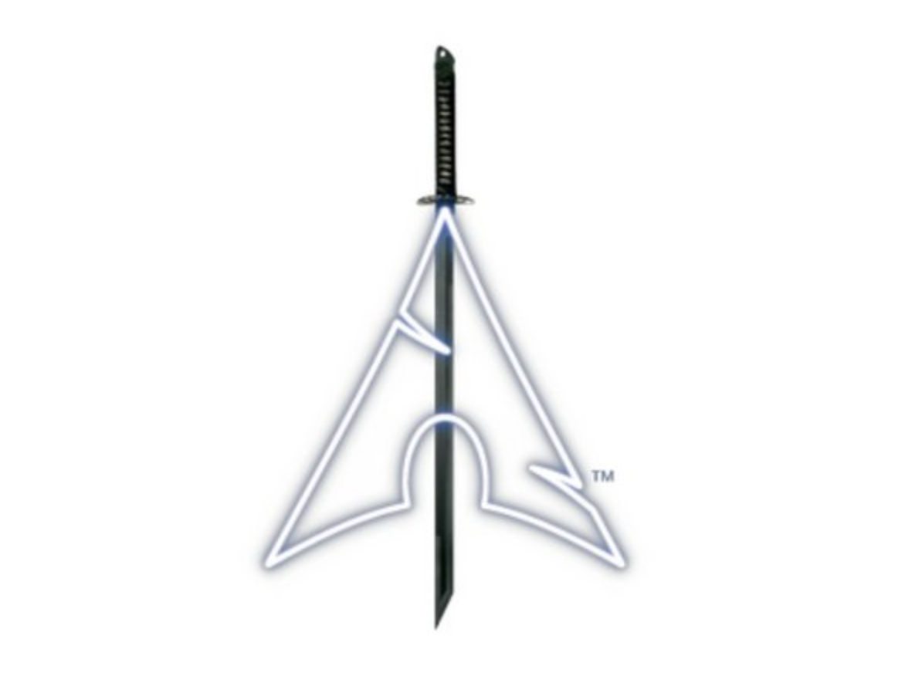
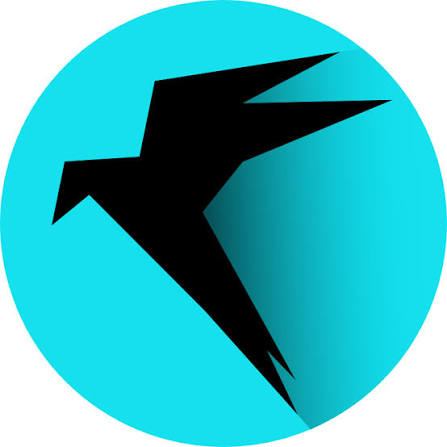

# Image Credits

This project uses logos and artwork associated with Linux distributions.

## 1. Odin Project Landing Page Design

- **Image:** \
  
- **Credit:** The Odin Project
- **Source:** [Odin Project Landing Page](https://www.theodinproject.com/lessons/foundations-landing-page#project-solution)

## 2. BackBox Linux Logo

- **Image:** \
   
- **Credit:** BackBox Linux; image referenced in a LinuxInsider article.
- **Source:** [BackBox Takes Its Security Tools Seriously](https://www.linuxinsider.com/story/backbox-takes-its-security-tools-seriously-82676.html)

## 3. BlackArch Linux Logo

- **Image:** \
   
- **Credit:** BlackArch Linux; image referenced on iFixit.
- **Source:** [iFixit — BlackArch](https://www.ifixit.com/Device/BlackArch)

## 4. Kali Linux Logo

- **Image:** \
   
- **Credit:** Kali Linux; image referenced on XDA Developers.
- **Source:** [XDA Developers — Kali Linux](https://www.xda-developers.com/kali-linux/)

## 5. Parrot OS Logo

- **Image:** \
   
- **Credit:** Parrot Security / Parrot OS.
- **Source:** [Official Parrot OS website](https://parrotsec.org/)

## 6. Parrot OS Artwork

- **Image:** \
   
- **Credit:** Parrot Security / Parrot OS
- **Source:** [Parrot OS documentation](https://parrotsec.org/blog/2019-04-26-parrot-4-6-release-notes/)
